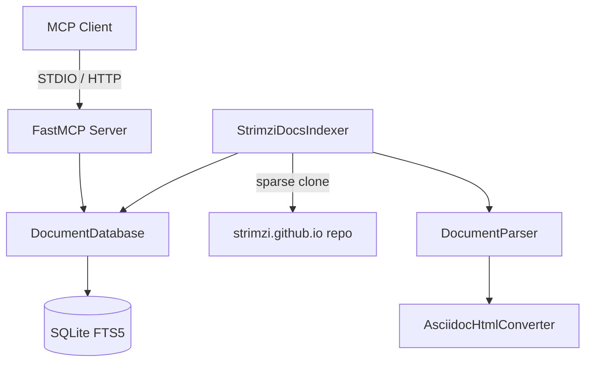

# Claude Code Instructions

This file provides context for Claude Code when working with this project.

## Project Overview

This is an MCP (Model Context Protocol) server for Strimzi documentation. It provides two tools:

1. `search_documentation` - Full-text search of Strimzi docs using SQLite FTS5
2. `read_documentation` - Retrieve full content of a documentation page or book section

Content comes from the Jekyll sources of [strimzi.github.io](https://github.com/strimzi/strimzi.github.io): the
`contributing`, `_posts`, `docs` (latest operator and bridge books only), `glossary` and `quickstarts` paths.

## Architecture



## Key Files

| File | Purpose |
|------|---------|
| `src/mcp_strimzi_documentation/server.py` | FastMCP server with tool definitions |
| `src/mcp_strimzi_documentation/database.py` | SQLite FTS5 operations |
| `src/mcp_strimzi_documentation/parser.py` | Jekyll markdown parser (frontmatter, Liquid, URLs, books) |
| `src/mcp_strimzi_documentation/html_converter.py` | Splits Asciidoctor HTML books into markdown sections |
| `src/mcp_strimzi_documentation/indexer.py` | Sparse clone and index of strimzi.github.io |
| `src/mcp_strimzi_documentation/cli.py` | CLI for indexing commands |

## Common Commands

```bash
# Initialise development environment
make init

# Run tests with coverage
make test

# Run full build (lint + typecheck + test)
make build

# Format code
make format

# Build documentation index
make index

# Run MCP server
make run
```

## Development Notes

- Python 3.12+ required
- Uses uv for package management
- Ruff for linting/formatting
- mypy for type checking
- pytest for testing

## Data Flow

1. **Indexing**: Sparse clone strimzi.github.io → Parse markdown → Resolve `include_relative` HTML books and split
   them into sections → Store in SQLite FTS5
2. **Search**: Query → FTS5 MATCH (with quoted-term fallback for invalid syntax) → BM25 ranking → Return results
3. **Read**: Path → Database lookup → Return document content

## Indexing Notes

- The indexed paths are defined in `StrimziDocsIndexer.SOURCE_PATHS`; only `docs/*/latest` is indexed to avoid
  duplicating every historical release
- `docs/operators/latest/contributing.md` is excluded because it duplicates `contributing/guide/index.md`
- Sections: `_posts` → `blog`, `docs/<product>/...` → `<product>` (`operators`, `bridge`), otherwise the top-level
  directory
- Book section paths are `<page>.md#<anchor>`; the bare page path is a table of contents document
- `!LATEST_OPERATOR_VERSION!` and `!LATEST_BRIDGE_VERSION!` are replaced using `_data/releases.yaml`

## Dependencies

- `fastmcp` - High-level MCP server framework
- `python-frontmatter` - Parse YAML frontmatter from markdown
- `beautifulsoup4` - Parse Asciidoctor HTML books
- `markdownify` - Convert HTML sections to markdown
- `pyyaml` - Read release data

## Testing

Tests use pytest with fixtures defined in `tests/conftest.py`, including a minimal strimzi.github.io layout
(`site_repo`). Database tests use temporary directories to avoid polluting the development database.

```bash
# Run specific test file
uv run pytest tests/test_parser.py -v

# Run with coverage report
uv run pytest --cov=src/mcp_strimzi_documentation
```
