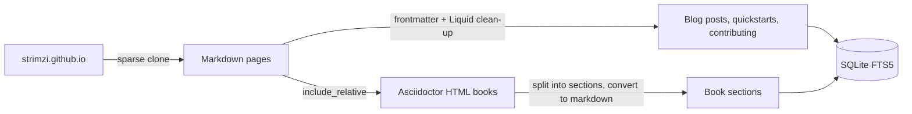

# Usage Guide

This guide explains how to use the Strimzi Documentation MCP Server.

## Prerequisites

- Python 3.12 or later
- [uv](https://github.com/astral-sh/uv) package manager
- Git 2.27 or later (for the sparse clone of strimzi.github.io during indexing)

## Setup

### 1. Initialise the Environment

```bash
make init
```

This installs all dependencies using uv.

### 2. Build the Documentation Index

```bash
make index
```

This performs a sparse clone of the [strimzi.github.io](https://github.com/strimzi/strimzi.github.io) repository
and indexes the documentation into a local SQLite database.

### 3. Run the Server

```bash
make run
```

The server runs using STDIO transport and is ready to receive MCP requests. Set `MCP_TRANSPORT=http` to run as a
long-lived HTTP server instead, optionally with `MCP_HOST` and `MCP_PORT` (defaults `0.0.0.0` and `8000`).

## How Content Is Indexed



- **Markdown pages and blog posts** are indexed as one document each. Liquid tags are removed (the bodies of
  `` blocks are kept verbatim), `post_url` links are resolved to strimzi.io URLs and blog posts use their
  excerpt as the description.
- **Documentation books** (pages that `include_relative` an Asciidoctor HTML file) are split into level 1 and level
  2 sections. Each section becomes its own document with an anchor in its path and URL, and the book page itself
  becomes a table of contents listing every section.
- **Version placeholders** such as `!LATEST_OPERATOR_VERSION!` are replaced with the latest versions from
  `_data/releases.yaml`.

## MCP Tools

### search_documentation

Search the Strimzi documentation using full-text search with stemming support.

**Parameters:**

| Parameter | Type | Required | Default | Description |
|-----------|------|----------|---------|-------------|
| `query` | string | Yes | - | Search terms |
| `section` | string | No | None | Filter by section |
| `limit` | integer | No | 10 | Max results (1-50) |

Queries support FTS5 syntax (for example `"node pool"`, `kafka AND connect` or `rebalanc*`). Queries that are not
valid FTS5 syntax, such as `kafka-connect`, are retried with each word matched as a quoted term.

**Available Sections:**

- `operators` - Overview, Deploying and Managing, and Configuring books for the Strimzi operators
- `bridge` - HTTP Bridge book
- `blog` - Strimzi blog posts
- `quickstarts` - Minikube, Kind and Docker Desktop quickstarts
- `glossary` - Glossary of terms
- `contributing` - Contributing guidelines and the documentation contributor guide

**Example Response:**

```json
{
  "query": "node pool",
  "section_filter": null,
  "result_count": 1,
  "results": [
    {
      "title": "Configuring node pools",
      "url": "https://strimzi.io/docs/operators/latest/deploying.html#config-node-pools-str",
      "path": "docs/operators/latest/deploying.md#config-node-pools-str",
      "section": "operators",
      "snippet": "...configuration for a <mark>node</mark> <mark>pool</mark> in a cluster...",
      "relevance_score": 12.5432
    }
  ]
}
```

### read_documentation

Retrieve the full content of a specific documentation page or book section.

**Parameters:**

| Parameter | Type | Required | Description |
|-----------|------|----------|-------------|
| `path` | string | Yes | Path to document, as returned in search results |

**Example Response:**

```json
{
  "path": "docs/operators/latest/deploying.md#cluster-operator-str",
  "title": "Deploying the Cluster Operator",
  "description": "Deploying and Managing (1.2.0): Deploying Strimzi using installation files",
  "section": "operators",
  "url": "https://strimzi.io/docs/operators/latest/deploying.html#cluster-operator-str",
  "date": null,
  "content": "# Deploying the Cluster Operator\n\nThe first step for any deployment of Strimzi..."
}
```

The `date` field holds the publication date of blog posts and is `null` for other documents.

## CLI Commands

### Index Documentation

```bash
# Index from main branch
make index

# Or use the CLI directly
uv run strimzi-docs-index index

# Index from a specific branch
uv run strimzi-docs-index index --branch main

# Rebuild index (clear existing data first)
uv run strimzi-docs-index index --rebuild
```

### Show Index Statistics

```bash
uv run strimzi-docs-index stats
```

## Configuration

### Database Location

By default, the SQLite database is stored at `data/strimzi_docs.db` relative to the project directory. You can
specify a custom location:

```bash
uv run strimzi-docs-index --database /path/to/custom.db index
```

## Integrating with MCP Clients

### Claude Desktop

Add to your Claude Desktop configuration:

```json
{
  "mcpServers": {
    "strimzi-docs": {
      "command": "uv",
      "args": ["run", "mcp-strimzi-docs"],
      "cwd": "/path/to/mcp-strimzi-documentation"
    }
  }
}
```

### Other MCP Clients

The server uses STDIO transport by default, so it can be integrated with any MCP client that supports STDIO-based
servers. Use `make docker-run-http` to run it over HTTP on port 8000.
